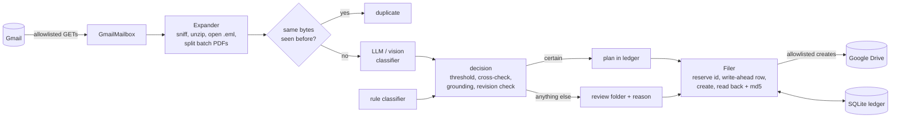

# mailroom

**Files the documents that arrive by email into the right cloud-drive folder, without ever
changing the mailbox, overwriting a file, or losing track of a document when the process dies
halfway.** Invoices, receipts and contracts come in through Gmail (as attachments, inside zips,
inside forwarded emails, or as several documents scanned into one PDF). They are classified by
an LLM/vision model that is never trusted on its own, and filed into Google Drive as
`Invoices/2026/Blue Fern Hosting/2026-03-14 Blue Fern Hosting BF-2041.pdf`. Anything short of
certain goes to a review folder with a reason.


```text
$ mailroom demo
  filed     m01/BF-2041.pdf                Invoices/2026/Blue Fern Hosting/2026-03-14 Blue Fern Hosting BF-2041.pdf
  filed     m02/inkwell-receipt-881.pdf    Receipts/2026-03/2026-03-20 Inkwell & Co. Printing receipt_2.pdf
  skipped   m03/logo.png                   (inline_image)
  filed     m07/IMG_0412.png               Receipts/2026-03/2026-03-28 Kestrel Couriers receipt.png
  review    m08/spring-catalogue.pdf       Needs review/spring-catalogue.pdf (unrecognized_type)
  ...
requests the allowlist let through, by rule:
  drive.files.upload         10
  gmail.messages.get         10
  ...
```

## What's inside

| | |
|---|---|
| **Read-only intake, enforced on the wire** | Every outbound request (Gmail, Drive, OAuth, the model) is matched against an explicit allowlist of method, host, path pattern, query keys and, for writes, the request body, *before* it is sent. Gmail has three read endpoints in that table and nothing else. Next-page tokens are re-validated and spliced into mailroom's own URL; a URL the server returns is never requested. |
| **Write-ahead, hash-verified filing** | A file id is reserved and a ledger row (folder, name, md5, sha256, size) is committed before every upload. A document counts as filed only after the stored copy is read back and matches. After a crash, recovery rolls forward, resumes or rolls back each unfinished filing. Nothing can update, move or delete a file, so nothing is ever overwritten. |
| **Containers and batch scans** | File types are decided by content. Zips and attached emails are opened (with zip-bomb, encryption and depth limits) and their files filed separately. PDFs holding several documents are split by a pluggable splitter, but only when the cut points are certain. |
| **Classification that has to show its work** | A pluggable LLM/vision classifier proposes a type and fields. They are used only if confidence clears the type's threshold, an independent rule classifier doesn't disagree, and every value that goes into a folder or file name appears in the document's own text. |
| **An offline gate with zero tolerance** | 3 synthetic corpora (47 documents) x 3 transports x 3 modes (live, preview, a crash at every write) run with fakes for every external service. One misfile fails CI. |
| **Tested without an account** | 367 tests, about 20 s, no network, no keys. The real Gmail/Drive adapters, allowlist, retries and OAuth run against an in-process simulation of the Google REST APIs. |

## Architecture



Every request from every adapter goes through the same layers
([`app.google_stack`](src/mailroom/app.py)):

```text
GmailMailbox / GoogleDrive
  -> AuthorizedTransport   bearer token; one refresh and one retry on a 401
  -> RetryingTransport     backoff on 429/5xx; network errors retried only for idempotent requests
  -> GuardedTransport      the allowlist (guard.py + google/policy.py); BlockedRequest stops the run
  -> wire                  urllib in production (redirects are not followed), simulators in tests
```

A filing, step by step ([`filing.py`](src/mailroom/filing.py)):

```mermaid
sequenceDiagram
    participant F as Filer
    participant L as Ledger (SQLite)
    participant D as Drive
    F->>D: files.generateIds (reserve an id; nothing stored yet)
    F->>L: INSERT intent (id, folder, name, md5, sha256, size) - committed
    F->>D: create the file with that id (multipart upload)
    Note over F,D: a crash here leaves a row that names exactly which file to look for
    D-->>F: 200, or 409 when an earlier attempt already landed
    F->>D: files.get(id): parents, name, size, md5Checksum
    F->>L: mark done only if all four match the row
```

### The parts that are harder than they look

**1. A URL allowlist is not enough.** Matching method and path is the easy part. The guard
([`guard.py`](src/mailroom/guard.py)) also refuses unknown and repeated query keys, credentials
in the URL, fragments, other ports, `..` and `//` path segments, and method-override headers.
Many HTTP APIs honour `X-HTTP-Method-Override`, which would let an allowlisted POST run as a
PATCH or DELETE. Write rules inspect the body
([`google/policy.py`](src/mailroom/google/policy.py)). An upload must be a well-formed two-part
multipart body whose metadata carries a reserved id, exactly one parent, a parent mailroom
manages, no keys beyond `id/name/mimeType/parents/description`, and is not a folder. A Drive
listing query must match the one grammar the adapter builds, so a vendor named
`x' or name contains '` is escaped into a literal and cannot widen the search. Page tokens get
the same treatment: they are checked against an opaque-token charset, a repeat is refused (it
would loop forever), pages are capped, and the token goes into mailroom's own URL. A token that
is really `https://attacker.example.com/...` stops the listing; nothing is fetched from it. The
attachment's MIME type comes from the sender, so it is reduced to `type/subtype` before it goes
into a multipart header.

**2. Retrying a create is only safe if the create is idempotent.** If an upload's response is
lost, the client cannot tell whether the file landed. Mailroom reserves the id first
(`files.generateIds`) and creates the file *with* that id. A retry of a request that already
landed is rejected with 409 instead of making a second copy, and that is exactly what makes it
safe for the retry layer to resend creates after a network error
([`policy.is_idempotent`](src/mailroom/google/policy.py)). The allowlist requires a reserved id
on every create, so this cannot regress quietly.

**3. "Uploaded" is not "filed".** A filing is done only when the stored copy has been read back
and its folder, name, size and md5 match the write-ahead row. On startup, `recover()` settles
every row a crash left behind. If the copy landed and matches, the filing is rolled forward. If
it never landed and the bytes are at hand, it is re-sent with the same id. Otherwise it is rolled
back, so the next run files the document from the mailbox again. A copy that landed but does not
match is a *conflict* for a person, and a copy that lands after its intent was rolled back is
reported as an *orphan*. Neither is ever overwritten or deleted.

**4. Decisions are written ahead too.** If the process dies after deciding where a document goes
but before filing it, the next run must not ask the model again: a non-deterministic model can
answer differently, and the document would be filed somewhere other than where the first run
planned it. The decision is committed to the ledger before any write and the re-run finishes it
([`pipeline._document`](src/mailroom/pipeline.py); tested by changing the model's answer between
the crash and the restart).

**5. Models are confidently wrong.** A confidence threshold alone would file a quote as an
invoice at 0.95. [`routing.decide`](src/mailroom/routing.py) also requires:
- **Agreement**: an independent keyword/pattern classifier must not point to a different type,
  and must not have ruled the type out ("quote", "estimate", "credit note" rule out invoice).
- **Grounding**: every field used in the folder or file name must appear in the document's own
  text, as whole words: `INV-204` is not grounded by `INV-2041`. Dates are read in the
  configured order only, because guessing between 03/04 and 04/03 is exactly how a document
  lands in the wrong month.
- **Images**: a photo has no text of its own, so its fields are grounded in the model's
  transcript, the bar is higher (0.95), and the label must agree with what the model itself read.
- **Revisions**: a document with the same type, issuer and number as one already filed, but
  different bytes (a corrected invoice), goes to review instead of becoming a second "truth".

Templates are a tiny format of their own, not `str.format`. A value cannot reach attributes or
add folder levels: a vendor called `../../Payroll` lands in `Invoices/2026/-..-Payroll/`.

**6. Containers lie.** Types come from content, not names. A `.docx` is a zip and must not be
unpacked, and a PDF called `photo.jpg` is a PDF. A zip that stores a PDF uncompressed contains
`%PDF-` in its first kilobyte; the tests caught the sniffer calling such zips PDFs. Archive
limits are checked on the declared sizes and again while reading, because declared sizes are
attacker-controlled. Encrypted, corrupt, over-limit or too-deeply nested containers are filed
whole for review, never dropped. The container itself is never filed: its files are.

**7. A wrong cut is worse than no cut.** The default splitter
([`split.py`](src/mailroom/split.py)) starts a new document where a new document number or
"Page 1 of N" appears, and only cuts when every part starts with a number and every page has
text. Otherwise the file goes to review as `possible_multiple_documents`. Splitters are
pluggable ([`examples/custom_splitter.py`](examples/custom_splitter.py)).

## The evaluation gate

`mailroom eval` runs every combination of:

| | |
|---|---|
| **corpora** | `everyday` (11 documents): invoices, receipts, a contract, a phone photo, an HTML receipt, an unwanted catalogue, name collisions with the owner's own files, sent and spam mail that must not be taken in. `containers` (17): zips, forwarded emails, a 4-page batch scan of 3 invoices, an unsure batch, an encrypted zip, a zip bomb, nesting past the limit, a locked PDF, a signature file. `adversarial` (19): a model that is confidently wrong on a look-alike quote, hallucinates a number, a vendor and a date, mislabels a receipt, obeys a prompt injection, returns garbage, is down, and is over-confident on a blurry photo; plus a re-sent and a corrected invoice and a path-traversal vendor name. |
| **transports** | `memory` (in-memory fakes behind the ports); `http` (the production Gmail/Drive adapters, allowlist, retries and OAuth against the simulated Google REST API); `http-faults` (the same with 503s and lost responses injected) |
| **modes** | `live` (run until nothing is deferred, then score every document); `preview` (must write nothing, change no state, and agree with a live run); `crash` (kill the process before *and* after every write that lands, restart, finish; the result must be identical to an uninterrupted run) |

Every document has an exact expected outcome (a path, or a review/skip/duplicate reason).
A **misfile** is any document filed outside the review folder anywhere but its expected path,
including documents that should have gone to review, and any stray file on the drive. Other
differences are **mismatches**. Floor **violations** cover mailbox writes, drive writes outside
the filing root, a preview that writes, conflicts or orphans in the ledger, and an owner's file
changed. A cell passes only with zero of each.

```text
$ mailroom eval
corpus       transport    mode      docs  filed  review  crashes  misfiles  other   secs  result
everyday     memory       live        11      9       1        0         0      0   0.03  PASS
...
adversarial  http-faults  crash       19      3      14       53         0      0   1.71  PASS
27 cells, 416 crash points, 0 misfiles, 0 mismatches, 0 violations: GATE PASSED
```

Two checks keep the gate honest. The scorer is tested on its own: it must flag a wrong path, a
filed review case, a filed duplicate, a lost document and a stray file. And the gate has teeth:
with the cross-check and grounding switched off
(`mailroom eval --corpus adversarial --disable cross_check --disable grounding`) the adversarial
corpus misfiles and the gate fails. The crash mode found a real bug during development: recovery
did not tolerate a re-sent folder create whose first reply had been lost.

What the gate is not: the model is scripted, so it proves that the pipeline catches the mistakes
models make; it does not measure any real model's accuracy.

## Quick start

Requirements: Python 3.11+. Nothing else for the offline parts.

```bash
git clone <this repository> mailroom && cd mailroom
python -m venv .venv && source .venv/bin/activate      # Windows: .venv\Scripts\activate
pip install -e ".[dev]"
mailroom demo                 # a synthetic mailbox, filed through the real adapters, offline
mailroom eval                 # the full gate, about 15 s
mailroom allowlist            # every request mailroom is allowed to make
python examples/offline_quickstart.py   # your own document type and classifier
```

To file a real mailbox:

1. In a Google Cloud project, enable the Gmail API and the Google Drive API and create an OAuth
   client. Run any OAuth installed-app flow (Google's `google-auth-oauthlib`, or
   `gcloud auth application-default login` with your client file) for the scopes
   `https://www.googleapis.com/auth/gmail.readonly` and `https://www.googleapis.com/auth/drive`,
   and save the resulting "authorized user" JSON (`client_id`, `client_secret`,
   `refresh_token`) as `token.json`.
2. Create the Drive folder to file into and copy its id from the URL.
3. `cp mailroom.example.toml mailroom.toml` and set `drive.root_folder_id`;
   `cp .env.example .env` and set `MAILROOM_LLM_API_KEY` (or use `kind = "rules"`, no model).
4. `mailroom run --config mailroom.toml --env-file .env --preview` shows what would happen and
   writes nothing. Then drop `--preview`, and schedule it (cron, a systemd timer).

Exit codes: `0` done, `1` something needs attention (conflicts, unreachable services),
`2` configuration or credentials, `3` a request was refused by the allowlist.

### Plug in your own pieces

The classifier is anything with `classify(document) -> Classification`, the splitter anything
with `plan(page_texts) -> SplitPlan`, and the mailbox and drive are small protocols
([`ports.py`](src/mailroom/ports.py)).
[`examples/offline_quickstart.py`](examples/offline_quickstart.py) files bank statements with a
custom type and classifier over the in-memory fakes. Whatever a custom classifier returns
still goes through the same thresholds and grounding checks.

## Configuration

`mailroom.toml` (see [`mailroom.example.toml`](mailroom.example.toml)). Unknown sections and
keys are errors, so a typo fails at startup.

| Key | Default | |
|---|---|---|
| `drive.root_folder_id` | required | the folder mailroom files into; it never writes outside it |
| `drive.review_folder` | `Needs review` | where anything uncertain goes, with the reason in the file's description |
| `drive.max_upload_mb` | `5` | Drive's single-request upload limit; larger documents are skipped and reported |
| `mailbox.query` | `""` | extra Gmail search terms; `has:attachment -in:sent -in:drafts -in:spam -in:trash` is always added |
| `mailbox.allowed_senders` | `[]` | shell-style patterns, e.g. `["*@example.com"]`; empty means everyone |
| `mailbox.max_attachment_mb` | `25` | larger attachments are skipped without being downloaded |
| `google.credentials_file` | `token.json` | Google authorized-user JSON; read, never written |
| `classifier.kind` | `llm` | `llm` (any OpenAI-compatible chat-completions endpoint) or `rules` |
| `classifier.endpoint` | OpenAI chat completions | must be https; the only model URL the allowlist admits |
| `classifier.model` | required for `llm` | a vision-capable model also reads photos |
| `classifier.api_key_env` | `MAILROOM_LLM_API_KEY` | the environment variable holding the key |
| `classifier.cross_check` / `grounding` | `true` / `true` | the safety checks above |
| `classifier.date_order` | `MDY` | how to read `03/04/2026`: `MDY` or `DMY` |
| `classifier.vision_min_confidence` | `0.95` | the bar for documents with no text of their own |
| `classifier.vendors` | `[]` | names the rule classifier may recognise |
| `classifier.max_attempts` | `3` | classifier failures before a document goes to review |
| `ledger.path` | `mailroom.db` | the SQLite ledger: write-ahead log, outcomes, audit events |
| `split.enabled` | `true` | split batch-scanned PDFs |
| `types.<name>` | invoice, receipt, contract | `description`, `folder` and `filename` templates, `keywords`, `exclude`, `number_pattern`, `min_confidence` |

## Testing

```bash
pytest                         # 367 tests, about 20 s, offline, no keys
ruff check src tests examples
mailroom eval                  # the gate (also a separate CI step that uploads a JSON report)
```

Every external service is faked: the mailbox and drive behind the ports
([`sim/memory.py`](src/mailroom/sim/memory.py)), the Gmail and Drive REST APIs at the HTTP level
with real wire formats, 409s, 404s, expiring tokens and injected faults
([`sim/google_api.py`](src/mailroom/sim/google_api.py)), and the model as a scripted
OpenAI-compatible endpoint ([`sim/model.py`](src/mailroom/sim/model.py)). Crashes are injected
as a `BaseException`, so no `except Exception` in the code under test can swallow one, just as no
handler runs when a real process is killed. CI runs lint, the tests and the gate on Python 3.11,
3.12 and 3.13.

## Security notes

- **Read-only intake does not depend on the token.** Grant `gmail.readonly`, but even a broader
  token could not change mail: the allowlist has no Gmail endpoint that changes anything, and
  the mailbox port has no method that could.
- **Drive scope versus behaviour.** Writing into a folder you created needs the full `drive`
  scope. The allowlist narrows it to: reserve ids, read metadata, list a folder by exact name,
  create folders and files inside the configured root. There is no update, move, copy, share or
  delete.
- **Secrets.** The credential file is only read. Access tokens live in memory and are never
  written or logged. The model API key comes from the environment. Credential errors do not
  repeat the secrets they are about (tested).
- **What leaves your machine.** With the `llm` classifier, each document's file name and text
  (up to 12,000 characters), or the image itself for an image-only document, go to the model
  endpoint you configure. With `rules`, documents go nowhere but your own Drive.
- **Prompt injection.** A document is untrusted input and so is the model's reply. A document
  can at most steer itself into the review folder or a folder its own text supports, inside the
  filing root. It cannot make mailroom send, delete, overwrite or write anywhere else. The
  adversarial corpus includes an injection attempt.
- **`allowed_senders` is a filter, not authentication.** A From header can be forged.
- **Protect the ledger.** It holds file names, hashes and folder ids (no document contents).
- **Run one instance at a time** (for example cron with `flock`): there is no cross-process lock
  yet.

## Limits

- Text is extracted from PDFs with a text layer, Word `.docx`, plain text, CSV, Markdown and
  HTML. Images go to the vision model. Scanned PDFs without a text layer, and other formats,
  usually end up in review.
- Uploads are single-request multipart, so documents over 5 MB are skipped and reported.
- The email body itself is not filed; only what is attached.

## Roadmap

- Outlook and OneDrive adapters behind the same ports (Microsoft Graph returns next-page *links*:
  the skip token would be extracted and re-validated, and the link never followed).
- Resumable uploads for large files, with the upload-session URL validated the same way.
- An `init` command that creates its own root folder, so the narrower `drive.file` scope is
  enough.
- Rendering scanned PDF pages for the vision model; filing the email body as a PDF.
- A cross-process run lock, and Gmail push notifications instead of polling.
- An online evaluation mode that replays recorded real-model answers.

## License

MIT
